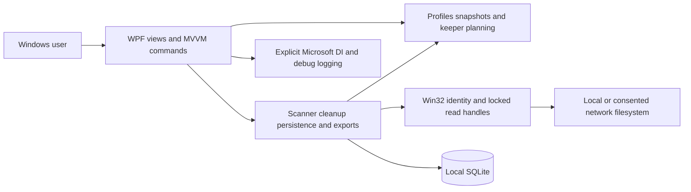
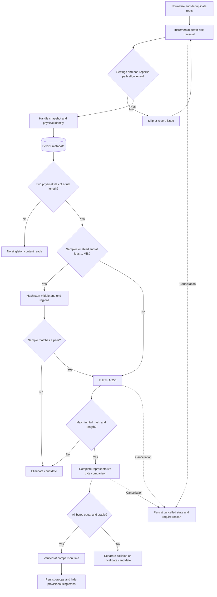
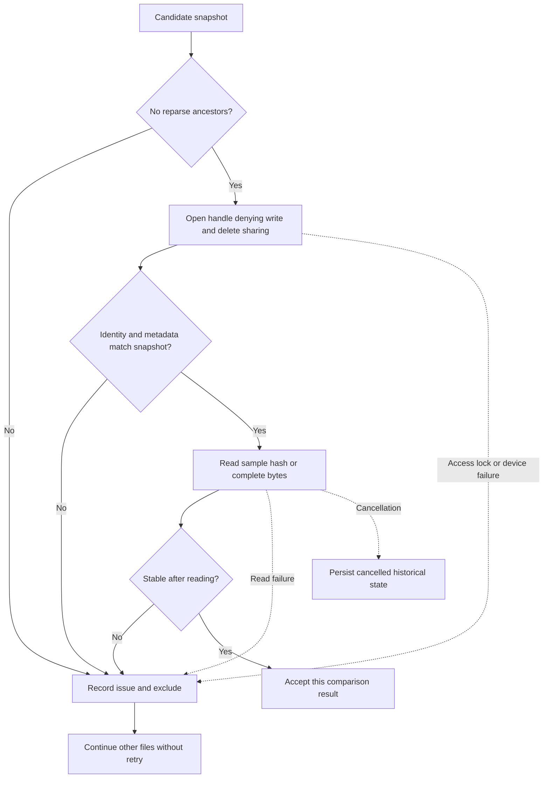
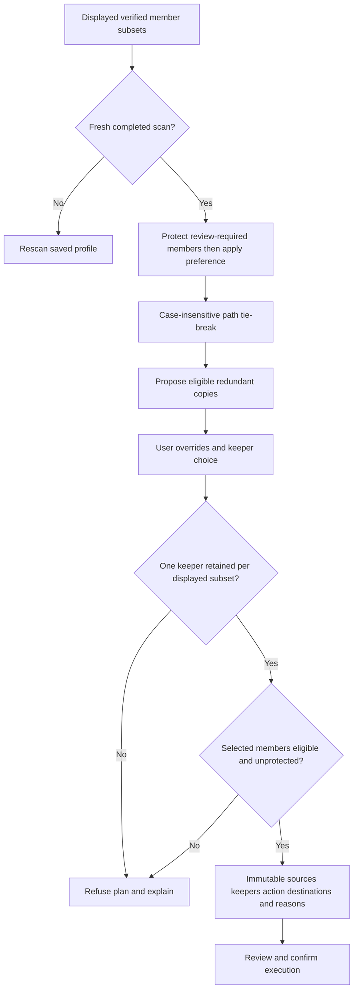
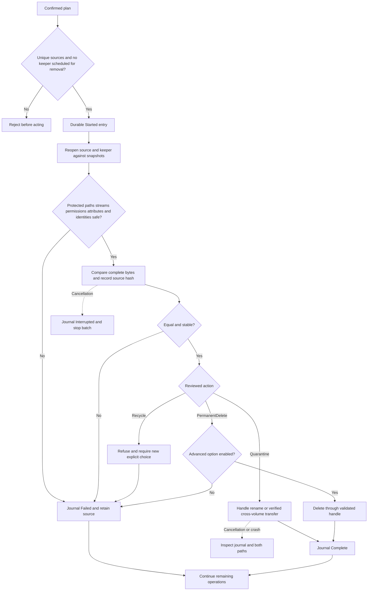
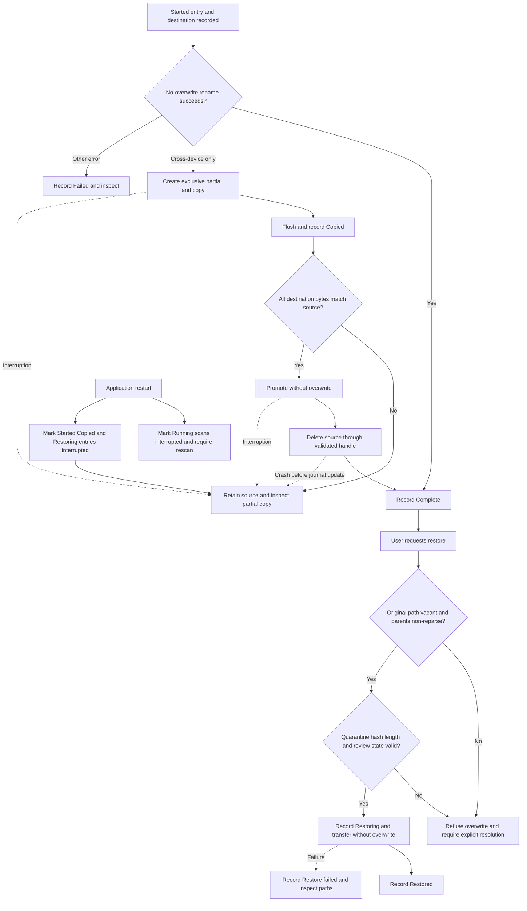
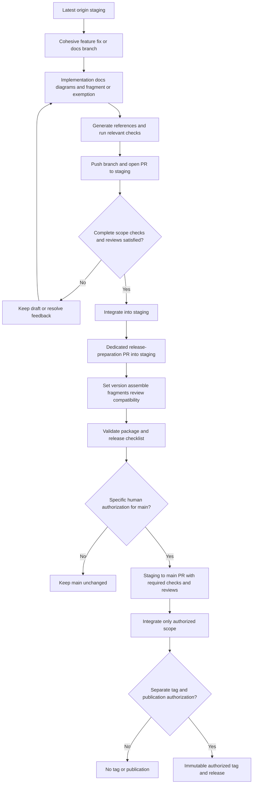

# Implementation diagrams

These Mermaid sources describe implemented paths and explicit refusals. CI renders every fence; reviewers still check semantics. The [persistent entity diagram](generated/entities.md) is generated from the SQLite initializer and labels logical relationships without implying foreign keys.

## Application architecture

## Scan pipeline

## Stability and failures

## Keeper selection and action planning

## Cleanup validation and execution

## Quarantine and recovery

## Git and release workflow

