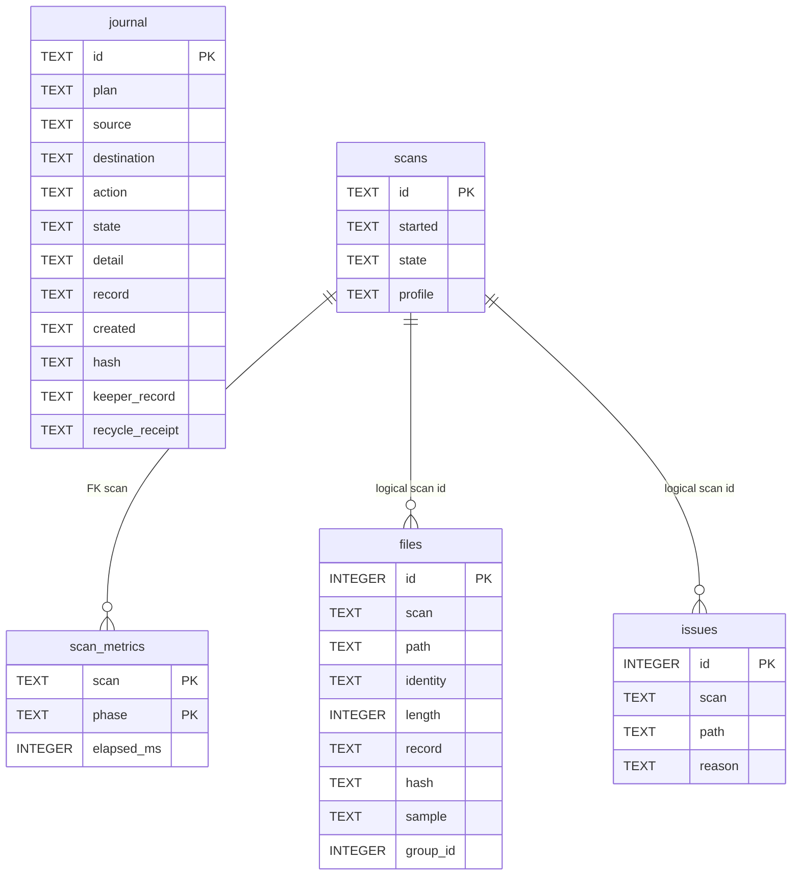

# Generated persistent entities

Generated from the same ordered migrations as the [structural reference](schema-reference.md).
Relationship labels distinguish logical links from enforced foreign keys.

`files.group_id` is a provisional representative file-row ID, without a foreign key or group table. `journal.plan` is an action-plan UUID without a persisted plan table. Journal snapshots intentionally survive independently of scan rows.
